# GitTogether

GitTogether is a small web app where students find teammates for projects and hackathons. You make a
profile with your skills, department and availability, browse other students, and send connection
requests. You can also upload a resume.

This repository is also my **DevOps capstone**. It takes the app from a laptop to a Kubernetes cluster on
AWS, with tests, security scanning, Terraform, GitOps and monitoring along the way. The screenshots below
come from a real run on Amazon EKS.


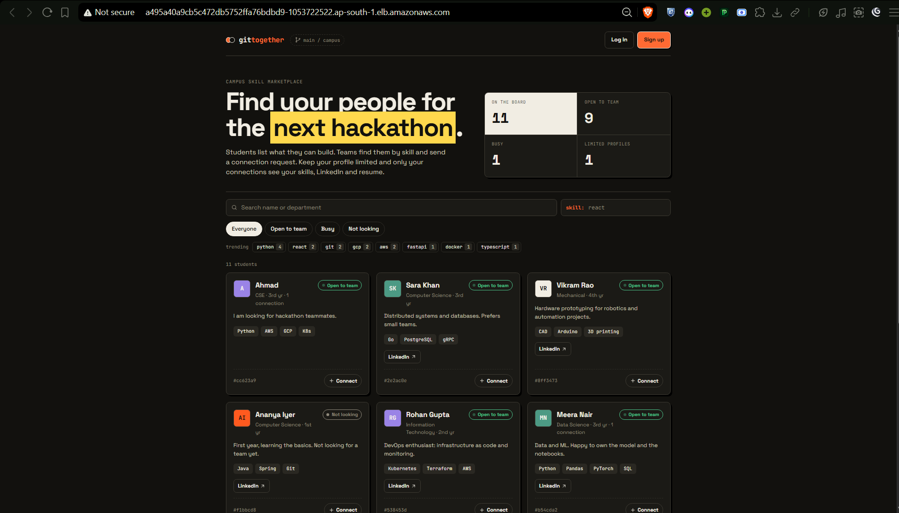

| Profile page | Connections |
|---|---|
| 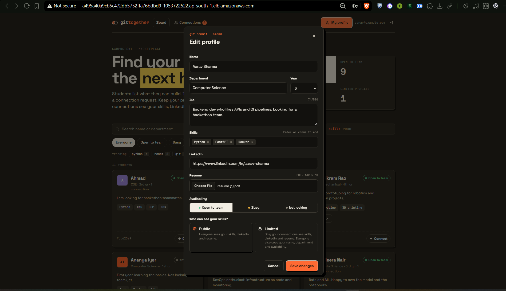 | 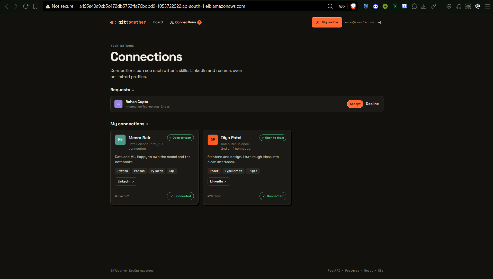 |

The slides are in [`demo/`](demo/) as `slides.pdf` and `slides.pptx`. The demo video is a release asset:
[watch or download it](https://github.com/AhmadAnzar/GitTogether/releases/tag/demo-video).

## Where to find each part

| Module | What | Section in this README | Proof |
|---|---|---|---|
| M1 | App: React, FastAPI, Postgres | [Architecture](#architecture), [API](#api) | [app](demo/screenshots/firstlook.png), [profile](demo/screenshots/profile.png) |
| M2 | Tests and lint | [Tests and linting](#tests-and-linting) | [pytest](demo/screenshots/pytest.png) |
| M3 | Git history | [Repository layout](#repository-layout) | [commits](demo/screenshots/commits.png) |
| M4 | Docker and Compose | [Run locally](#run-locally) | [compose](demo/screenshots/compose-up.png) |
| M5 | CI/CD pipeline | [CI/CD pipeline](#cicd-pipeline) | [green run](demo/screenshots/green-run.png), [GHCR images](demo/screenshots/ghcr-backend.png) |
| M6 | Trivy scan | [Security](#security) | [backend](demo/screenshots/trivy-be.png), [frontend](demo/screenshots/trivy-fe.png) |
| M7 | Terraform on AWS | [Infrastructure (Terraform)](#infrastructure-terraform) | [plan](demo/screenshots/tf-plan.png), [apply](demo/screenshots/tf-apply.png), [VPC](demo/screenshots/aws-vpc.png), [EKS](demo/screenshots/aws-eks-overview.png), [destroy](demo/screenshots/tf-destroy.png) |
| M8 | Kubernetes, Helm, ArgoCD, HPA | [Kubernetes / Helm](#kubernetes--helm) | [pods](demo/screenshots/kubectl-getpods.png), [ArgoCD](demo/screenshots/argocd-synced.png), [HPA](demo/screenshots/hpa-scaling.png), [troubleshooting](troubleshooting/README.md) |
| M9 | Prometheus and Grafana | [Observability](#observability) | [Prometheus](demo/screenshots/prometheus.png), [Grafana](demo/screenshots/grafana.png) |
| M10 | Slides, video and docs | this README, [`demo/`](demo/) | [slides.pdf](demo/slides.pdf), [demo video](https://github.com/AhmadAnzar/GitTogether/releases/tag/demo-video) |

## Project walkthrough

The demo video follows the slides with a live run on EKS. This section is the same walkthrough in
writing, with the commands I ran and the screenshots of the results, so each step can be checked
without watching the video. Every screenshot here comes from the real cluster.

### 1. Codebase

| Path | What it is |
|---|---|
| `backend/app/main.py` | FastAPI app: routers, `/health`, `/ready`, `/metrics` |
| `backend/app/routers/` | Auth, profiles and connections endpoints |
| `backend/app/models.py`, `schemas.py` | SQLAlchemy tables and Pydantic request/response shapes |
| `backend/app/security.py`, `access.py` | argon2 passwords, JWT cookie, the owner and privacy checks |
| `backend/alembic/versions/` | The two database migrations (profiles, then accounts and connections) |
| `backend/tests/` | 65 pytest tests on a separate test database, 90% coverage gate |
| `frontend/src/` | React app (`App.jsx`, `components/`, `api.js`) with Vitest tests |
| `backend/Dockerfile`, `frontend/Dockerfile` | Both run as non-root; the frontend is a two-stage Node build into Nginx |
| `.github/workflows/gittogether-ci.yml` | The pipeline: 7 jobs, actions pinned to commit SHAs |
| `terraform/` | VPC, EKS, node group, KMS key, Pod Identity for the EBS driver |
| `helm/gittogether/` | One chart for both clusters (`values-kind.yaml`, `values-eks.yaml`) |
| `argocd/application.yaml` | The ArgoCD Application: auto sync, prune and self-heal |
| `monitoring/` | Prometheus and Grafana values, and the API dashboard |
| `k8s/` | Namespace with Pod Security labels, Traefik and metrics-server values |

Choices worth knowing about:
- Images are tagged with the commit SHA, never `latest`, so every running pod traces back to one commit.
- The namespace enforces the Kubernetes `restricted` Pod Security level, so every pod runs as non-root
  with all capabilities dropped.
- Secrets (database password, JWT key) are created by `scripts/create-secrets.sh` at deploy time and are
  not in git.
- Worker nodes sit in private subnets; only the load balancer and the NAT gateway are public.

### 2. CI/CD

A push to `main` starts the pipeline: `secrets` (gitleaks), `backend` (ruff, pytest, coverage gate),
`frontend` (eslint, vitest, build), `terraform` (fmt, validate), `helm` (lint and kubeconform validation),
`config-scan` (Trivy on the IaC), and `images`. The `images` job builds both images, scans them with
Trivy (it fails on fixable HIGH or CRITICAL), and pushes them to GHCR tagged with the commit SHA. If
any earlier job fails, nothing is pushed.
[The pipeline](#cicd-pipeline), [a green run](demo/screenshots/green-run.png),
[the image jobs](demo/screenshots/pipeline-summary.png), [the images in GHCR](demo/screenshots/ghcr-backend.png).

### 3. Terraform and the AWS Console

```bash
cd terraform
terraform init
terraform plan          # 59 resources to add
terraform apply
terraform output        # cluster name, region, kubeconfig command
terraform destroy       # when done
```

[plan](demo/screenshots/tf-plan.png), [apply](demo/screenshots/tf-apply.png),
[VPC](demo/screenshots/aws-vpc.png), [subnets](demo/screenshots/aws-subnet.png),
[EKS cluster](demo/screenshots/aws-eks-overview.png), [worker nodes](demo/screenshots/aws-eks-compute.png),
[destroy](demo/screenshots/tf-destroy.png). Details are in [Infrastructure (Terraform)](#infrastructure-terraform).

### 4. Kubernetes

```bash
kubectl get pods -n gittogether
kubectl get svc -n gittogether
kubectl get ingress -n gittogether
helm list -n gittogether
```

[pods, services and the Helm release](demo/screenshots/kubectl-getpods.png),
[nodes](demo/screenshots/getnodes.png), [the app through the load balancer](demo/screenshots/firstlook.png).
The Ingress sends `/api` to the backend and `/` to the frontend:

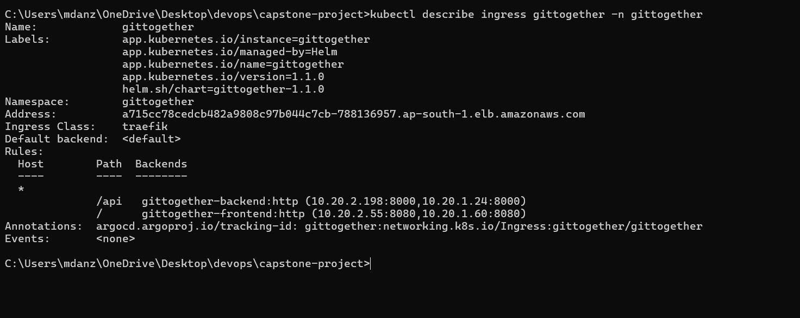

Details are in [Kubernetes / Helm](#kubernetes--helm).

### 5. ArgoCD and GitOps

ArgoCD watches this repo. A change to `helm/gittogether/values.yaml` on `main` is rolled out by ArgoCD,
and a change made by hand in the cluster is reverted (self-heal).
[Synced application](demo/screenshots/argocd-synced.png), [resource tree](demo/screenshots/argocd-tree.png).
Details are in [GitOps with ArgoCD](#gitops-with-argocd).

### 6. Prometheus and Grafana

[Prometheus targets showing the backend pods as UP](demo/screenshots/prometheus.png),
[the `/metrics` output](demo/screenshots/metrics.png) and
[the Grafana dashboard](demo/screenshots/grafana.png). Details are in [Observability](#observability).

### 7. Autoscaling under load

`scripts/load-test.sh` sends traffic at the load balancer. CPU went past the 70% target and the HPA
scaled the backend from 2 to 5 pods: [load test](demo/screenshots/loadtest.png),
[HPA scaling](demo/screenshots/hpa-scaling.png), [the new pods](demo/screenshots/hpa-pods.png).
Details are in [Autoscaling](#autoscaling).

---

## Architecture

```text
Developer ── git push ──► GitHub
                            │
                            ▼
                   GitHub Actions pipeline
   ┌──────────────┬────────────────┬──────────────────┬────────────────┬─────────────────┐
   │ gitleaks     │ backend        │ frontend         │ terraform      │ trivy config    │
   │ secret scan  │ ruff + pytest  │ eslint + vitest  │ fmt + validate │ (IaC, report)   │
   │              │ (≥90% cover)   │ + vite build     │                │                 │
   └──────────────┴───────┬────────┴────────┬─────────┴────────────────┴─────────────────┘
                          ▼                 ▼
                 docker build ──► Trivy image scan (fails on HIGH/CRITICAL) ──► push to GHCR
                                                                               (tag = commit SHA)

AWS (Terraform)                                   Kubernetes (Helm)
┌───────────────────────────────────────┐        ┌───────────────────────────────────────────┐
│ VPC 10.20.0.0/16, 2 AZs               │        │ Ingress  /     ──► frontend (nginx, React) │
│  public subnets:  load balancer, NAT  │ ─────► │          /api  ──► backend  (FastAPI)      │
│  private subnets: EKS worker nodes    │        │                       │                    │
│ EKS 1.35, 2 × m7i-flex.large, KMS secrets  │        │                   PostgreSQL (PVC)         │
└───────────────────────────────────────┘        │ HPA on backend · Prometheus + Grafana      │
                                                 └───────────────────────────────────────────┘
```

## Tech stack

| Layer | Tools |
|---|---|
| Frontend | React 18, Vite 5, plain CSS; served by non-root Nginx 1.30 |
| Backend | Python 3.12, FastAPI, SQLAlchemy 2, Alembic, Pydantic, Uvicorn; argon2 password hashing (pwdlib), JWT sessions (PyJWT) |
| Database | PostgreSQL 16 |
| Quality | pytest + pytest-cov (90% gate), ruff, ESLint, Vitest |
| Security | gitleaks, Trivy (image + config scans), GitHub code scanning, Dependabot |
| Containers | Docker (multi-stage frontend, non-root users), Docker Compose |
| CI/CD | GitHub Actions, GitHub Container Registry (GHCR) |
| Infrastructure | Terraform, AWS VPC, EKS, KMS |
| Kubernetes | Helm, Ingress (Traefik), HPA, metrics-server, Pod Security Admission (restricted), kind for local clusters |
| Observability | Prometheus, Grafana, `/metrics` via prometheus-fastapi-instrumentator |

## Repository layout

```text
.github/workflows/   CI/CD pipeline        backend/      FastAPI app, Alembic migrations, tests
.github/dependabot.yml                     frontend/     React app, Nginx config, tests
terraform/           AWS VPC + EKS          helm/         Helm chart for the app
k8s/                 namespace, kind/EKS add-on values   monitoring/   Prometheus/Grafana values
scripts/             load-test helper       troubleshooting/  deliberately broken manifests (lab)
demo/                screenshots, slides, demo video
```

## API

| Method | Path | Description |
|---|---|---|
| GET | `/health` | Liveness: the process is up |
| GET | `/ready` | Readiness: database reachable (503 if not) |
| GET | `/metrics` | Prometheus metrics |
| POST | `/api/auth/register` | Create an account (email + password) and log in |
| POST | `/api/auth/login` · `/api/auth/logout` | Start / end a session |
| GET | `/api/auth/me` | The logged-in user and their profile id |
| GET | `/api/profiles` | List profiles. Query: `skill`, `q` (name/department), `availability`, `limit` (≤100), `offset` |
| GET | `/api/profiles/stats` | Totals per availability, limited count, top public skills |
| GET | `/api/profiles/{id}` | One profile |
| POST | `/api/profiles` | Create your profile (one per account) 🔒 |
| PUT | `/api/profiles/{id}` | Update your profile (partial) 🔒 owner |
| DELETE | `/api/profiles/{id}` | Delete your profile 🔒 owner |
| PUT · DELETE | `/api/profiles/{id}/resume` | Upload (PDF, ≤ 5 MB) or remove your resume 🔒 owner |
| GET | `/api/profiles/{id}/resume` | Download a resume (subject to the privacy rule) |
| GET | `/api/connections` | Your connections 🔒 |
| GET | `/api/connections/requests` | Your pending requests: `incoming` and `outgoing` 🔒 |
| POST | `/api/connections/requests` | Send a connection request `{ "user_id": … }` 🔒 |
| POST | `/api/connections/requests/{id}/accept` · `/decline` | Answer a request you received 🔒 |
| DELETE | `/api/connections/requests/{id}` | Cancel a request you sent 🔒 |
| DELETE | `/api/connections/{user_id}` | Remove a connection 🔒 |

🔒 = requires login. Sessions use an `httpOnly`, `SameSite=Lax` cookie holding a signed JWT (24 h);
passwords are hashed with argon2 and never stored in plain text.

**Connections:** a request stays pending until the other person accepts (declining or cancelling
deletes it). Accepted connections are mutual.

**Privacy rule:** a `LIMITED` profile's skills, LinkedIn and resume are visible only to its owner and
their connections. The API removes those fields before responding, so the data never reaches anyone
else's browser, and hidden skills are excluded from skill search. Interactive docs:
`http://localhost:8000/docs`.

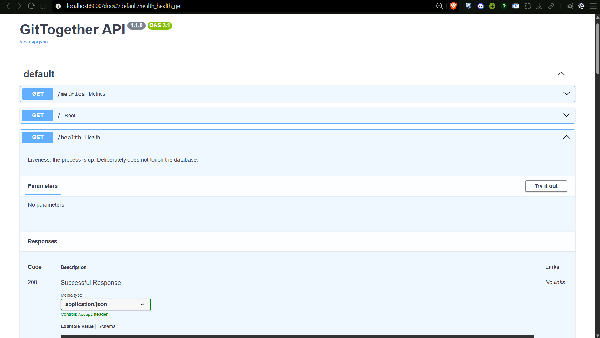

## Run locally

Requirements: Docker Desktop.

```bash
cp .env.example .env          # optional: change local database credentials
docker compose up --build
```

- App: http://localhost:3000
- API docs: http://localhost:8000/docs

All three services start and report healthy, and the app loads at `localhost:3000`:

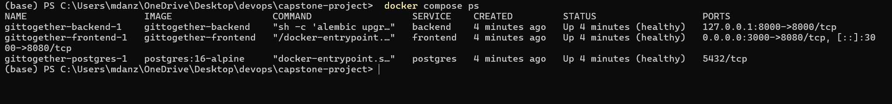

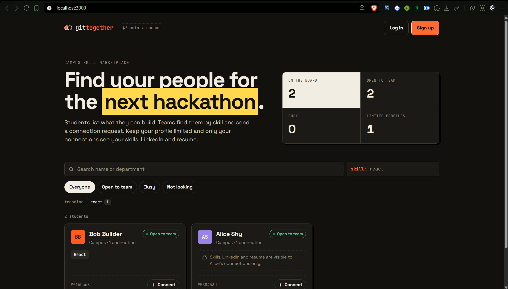

Postgres is not published on a host port; inspect it with `docker compose exec postgres psql -U gittogether`.
Stop with `docker compose down` (add `-v` to delete the database volume).

### Tests and linting

```bash
cd backend && pip install -r requirements-dev.txt && ruff check . && pytest -v
cd frontend && npm ci && npm run lint && npm test
```

The backend tests run against a separate SQLite database, not the real one. 65 tests pass with 99%
coverage, and the pipeline fails below 90%:

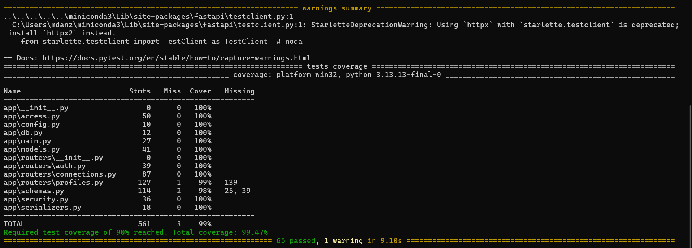

## CI/CD pipeline

Defined in [`.github/workflows/gittogether-ci.yml`](.github/workflows/gittogether-ci.yml). Runs on every
push and pull request to `main` (docs-only changes are skipped), and manually via **Run workflow**.

1. **Stage 1, in parallel:** gitleaks secret scan of the full history · backend ruff + pytest (fails
   below 90% coverage) · frontend ESLint + Vitest + build · Terraform fmt + validate · Helm lint + kubeconform
   schema validation of the rendered manifests · Trivy config scan
   of Dockerfiles, Kubernetes and Terraform (report-only, published to the Security tab).
2. **Stage 2, per image:** Docker build → **Trivy image scan that fails on fixable HIGH/CRITICAL CVEs** →
   push to `ghcr.io/ahmadanzar/gittogether/{backend,frontend}` tagged with the full commit SHA.
   Pull requests run everything except the push.

Third-party actions are pinned to full commit SHAs (the version is in a comment next to each one), and
Dependabot opens pull requests to update them. The Trivy action had its tags rewritten upstream in 2026,
which is why I pin by SHA.

A green run ([open it on GitHub](https://github.com/AhmadAnzar/GitTogether/actions/runs/38716349963)),
and the summary of the image jobs:

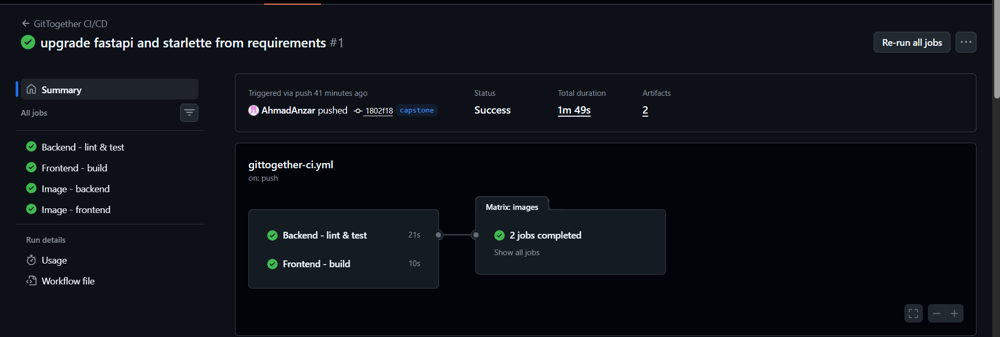

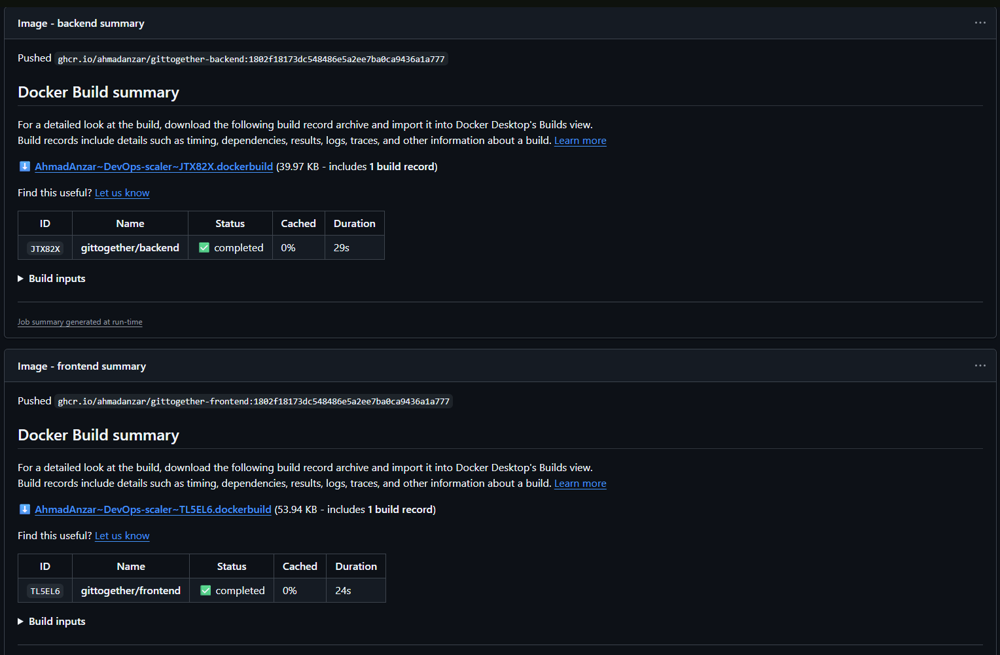

The images in the GitHub Container Registry, tagged with the commit SHA (never `latest`):

| Backend | Frontend |
|---|---|
| 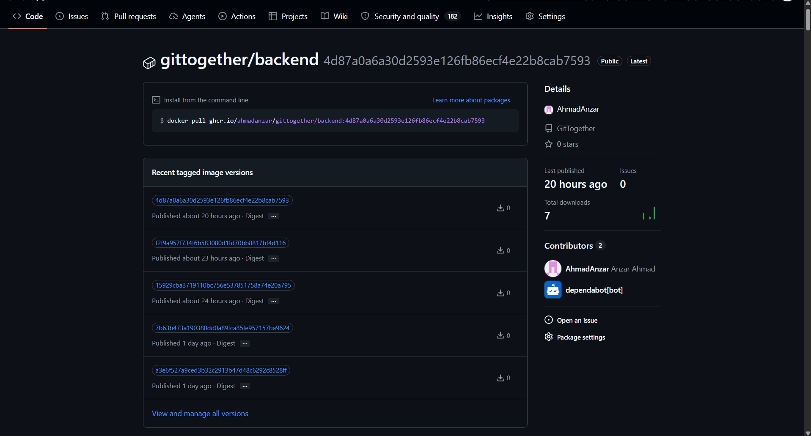 | 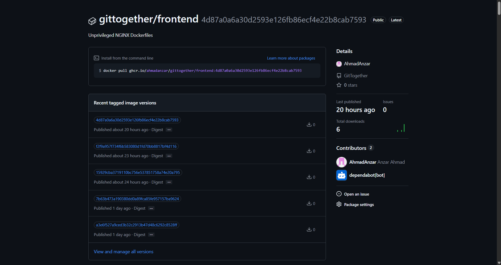 |

The commit history on `main`:

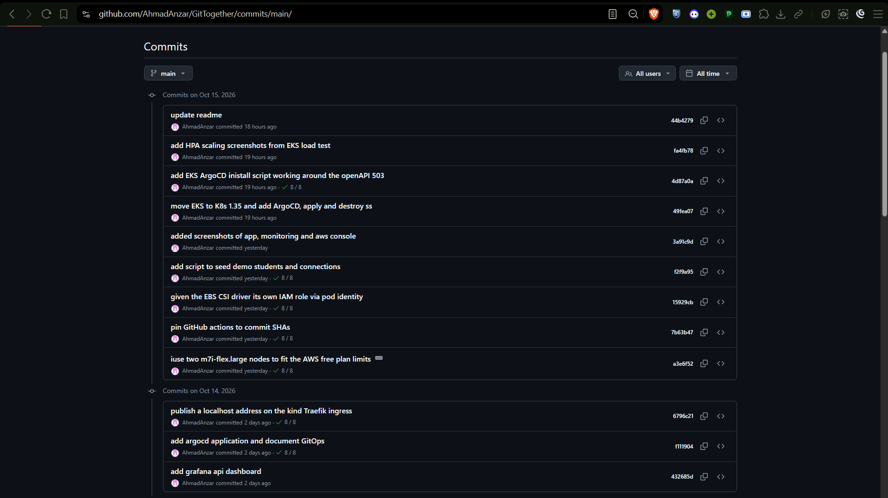

## Security

- **Trivy image scanning.** Trivy scans each built image's OS packages (Debian / Alpine) and application
  libraries (Python packages, npm) against vulnerability databases, and the pipeline fails if any
  HIGH or CRITICAL issue with an available fix is found. Its first run caught three HIGH CVEs in
  Starlette (e.g. CVE-2025-62727, a denial of service via crafted HTTP `Range` headers) and 41 issues in
  the old `nginx 1.27` / Alpine 3.21 base image; upgrading FastAPI/Starlette and moving to
  `nginx-unprivileged:1.30-alpine` (plus `apk upgrade`) brought both images to zero.

  | Backend image | Frontend image |
  |---|---|
  | 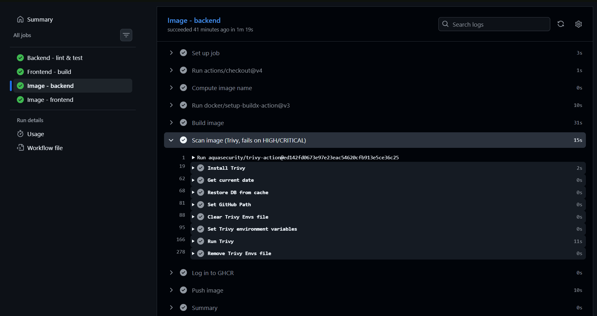 | 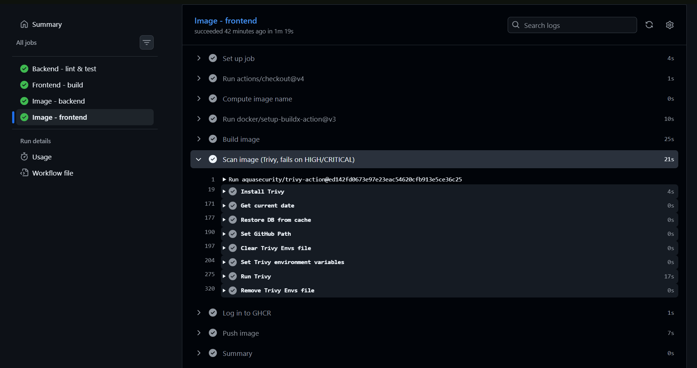 |
- **Trivy config scanning** checks Terraform, Dockerfiles and Kubernetes manifests. Deliberate trade-offs
  (public EKS endpoint, open node egress, no paid CloudWatch/flow logs) are listed with reasons in
  [`.trivyignore`](.trivyignore).
- **gitleaks** fails the pipeline if a secret appears anywhere in the git history.
- **Containers** run as non-root users (backend uid 10001, frontend uid 101); Nginx sends a strict
  Content-Security-Policy and other security headers and hides its version.
- **No credentials in git:** `.env`, `*.tfvars` and Terraform state are gitignored; AWS credentials come
  from the local AWS CLI profile.

## Infrastructure (Terraform)

See [`terraform/README.md`](terraform/README.md). Summary: a VPC with 2 public and 2 private subnets
across two AZs, one NAT gateway, and an EKS 1.35 cluster (standard support, KMS-encrypted Secrets) with
a managed node group of 2 × `m7i-flex.large` in the private subnets. Cost while running is about $0.40/hour,
so the cluster is created for demos and destroyed the same day.

```bash
cd terraform
terraform init && terraform plan
terraform apply
aws eks update-kubeconfig --region ap-south-1 --name gittogether-eks
```

The AWS free plan only allows a few instance types and 5 vCPUs in total (`t3.medium` was rejected), which
is why the nodes are `m7i-flex.large`. The EBS driver gets its AWS permissions through EKS Pod Identity,
because pods on current EKS nodes cannot use the node's metadata credentials.

What it looked like:

| `terraform apply` finished | `terraform destroy` finished |
|---|---|
| 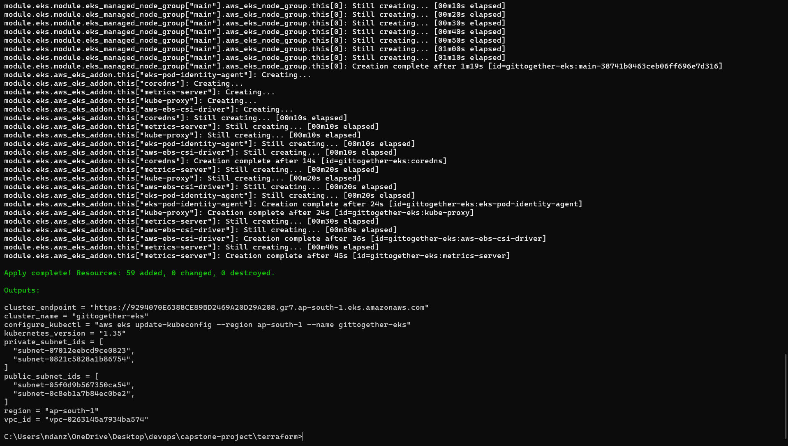 | 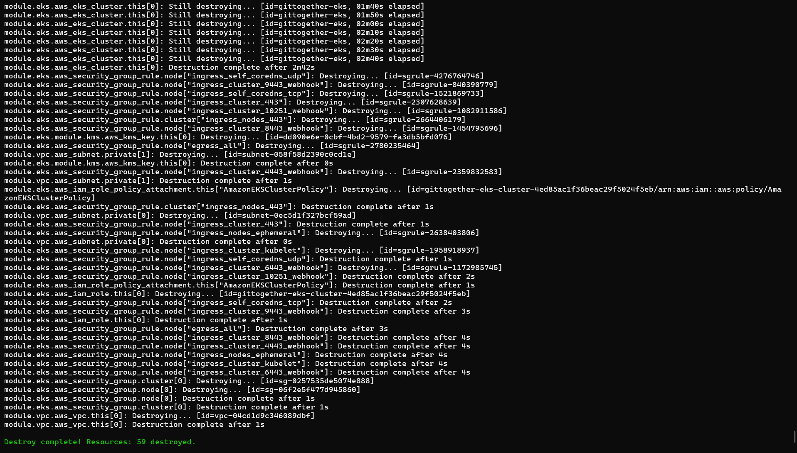 |

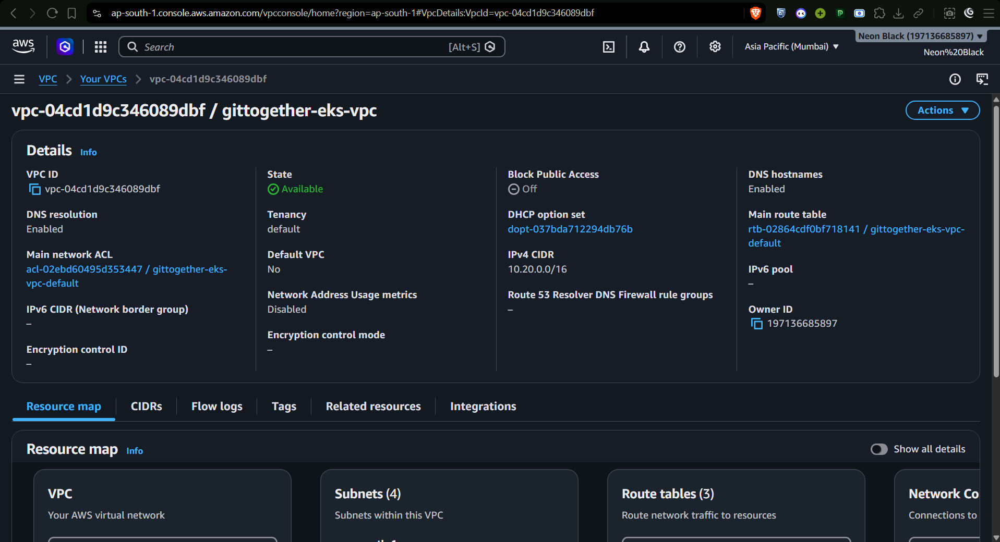

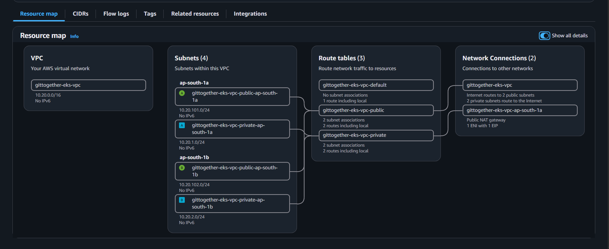

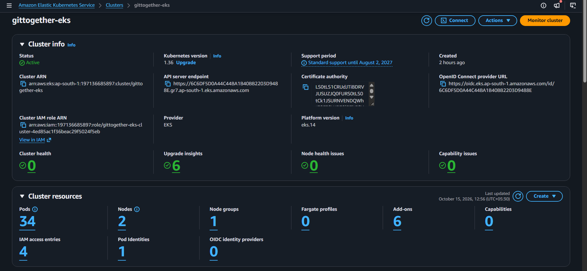

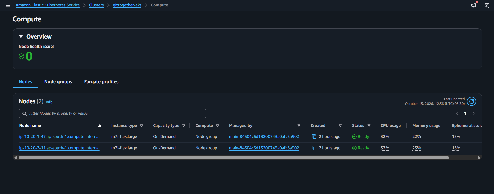

## Kubernetes / Helm

The app is packaged as a Helm chart in [`helm/gittogether`](helm/gittogether):

| Resource | Details |
|---|---|
| Backend `Deployment` | 2–5 replicas (HPA on CPU, 70% target). An init container runs `alembic upgrade head` first; a Postgres advisory lock makes replicas take turns. Liveness `/health`, readiness `/ready`. |
| Frontend `Deployment` | 2 replicas, non-root nginx; its `/api` proxy target comes from `BACKEND_URL`. |
| PostgreSQL `StatefulSet` | 1 replica with its own PersistentVolumeClaim (deleted on `helm uninstall`, so no disk is left behind). |
| `Service`s | ClusterIP for backend and frontend, headless for Postgres. |
| `Ingress` | `/api` → backend, `/` → frontend (Traefik). `/metrics` and `/ready` are not exposed (they fall through to the frontend's `index.html`); `/health` is proxied to the backend by nginx. |
| `HorizontalPodAutoscaler`, `PodDisruptionBudget`s | Scale the API on CPU; keep at least one pod of each component during node drains. |
| `ServiceMonitor` | Prometheus scraping of `/metrics` (enabled with the monitoring stack). |

**Security:** the `gittogether` namespace enforces the Kubernetes **restricted** Pod Security level, so
every pod must run as non-root, with a read-only root filesystem, no privilege escalation, all Linux
capabilities dropped and the RuntimeDefault seccomp profile; anything else is rejected at admission.
Passwords and the JWT key are **not in git or in values files**: `scripts/create-secrets.sh` creates
a Kubernetes Secret with random values, which the chart references.

**Ingress controller:** Traefik. The previously common ingress-nginx project was retired by the
Kubernetes project in March 2026 and no longer receives security fixes; Traefik implements the same
standard `Ingress` resource.

### Run it on a local cluster (kind)

```bash
kind create cluster --config k8s/local/kind-config.yaml        # maps host ports 80/443 to the cluster
helm repo add traefik https://traefik.github.io/charts
helm repo add metrics-server https://kubernetes-sigs.github.io/metrics-server/
helm upgrade --install traefik traefik/traefik --version 41.6.0 -n traefik --create-namespace -f k8s/local/traefik-values.yaml
helm upgrade --install metrics-server metrics-server/metrics-server --version 3.14.0 -n kube-system -f k8s/local/metrics-server-values.yaml

kubectl apply -f k8s/namespace.yaml
scripts/create-secrets.sh
helm upgrade --install gittogether helm/gittogether -n gittogether -f helm/gittogether/values-kind.yaml

kubectl get pods,svc,ingress,hpa -n gittogether
```

Open http://gittogether.localhost. Watch autoscaling with `scripts/load-test.sh` and
`kubectl get hpa -n gittogether -w`.

### Run it on EKS

After `terraform apply` and `aws eks update-kubeconfig ...`:

```bash
helm upgrade --install traefik traefik/traefik --version 41.6.0 -n traefik --create-namespace -f k8s/eks/traefik-values.yaml
kubectl apply -f k8s/namespace.yaml
scripts/create-secrets.sh
helm upgrade --install gittogether helm/gittogether -n gittogether -f helm/gittogether/values-eks.yaml
kubectl get svc -n traefik traefik      # EXTERNAL-IP = the AWS load balancer hostname to open
```

`values-eks.yaml` also creates a default `gp3` StorageClass (new EKS clusters have none).
metrics-server is installed on EKS by Terraform as a managed add-on.

Nodes and pods on EKS:

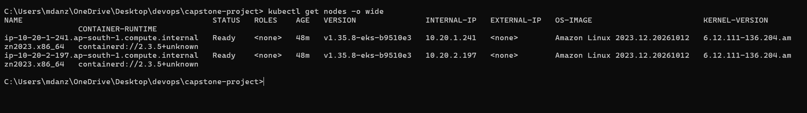

Pods, services and the Helm release (from the first run, deployed with `helm` directly; later runs
let ArgoCD deploy the same chart):

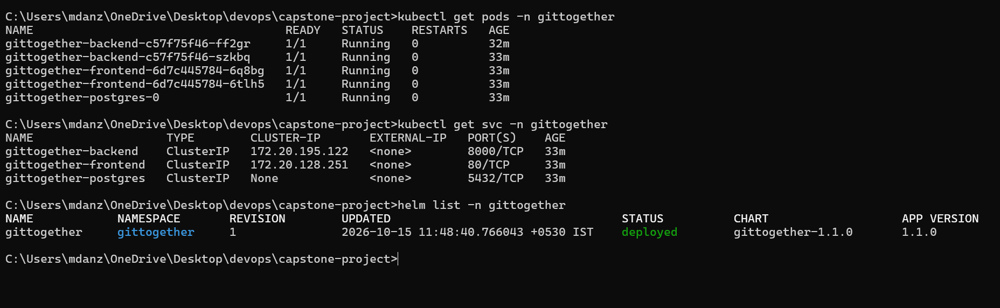

Checking the backend directly through a port-forward, and its Prometheus metrics:

| `/health` | `/metrics` |
|---|---|
| 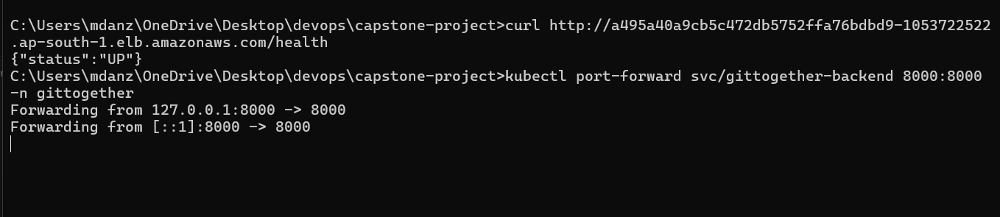 | 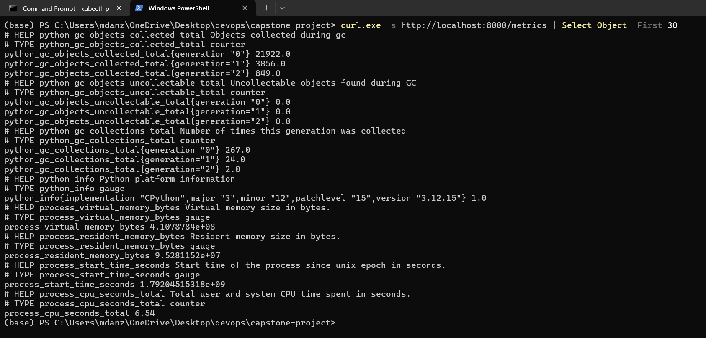 |

### Autoscaling

I ran `scripts/load-test.sh` against the load balancer. The backend CPU went to about 150% of the 70%
target, and the HPA grew the backend from 2 to 5 pods. When the load stopped, CPU dropped back.

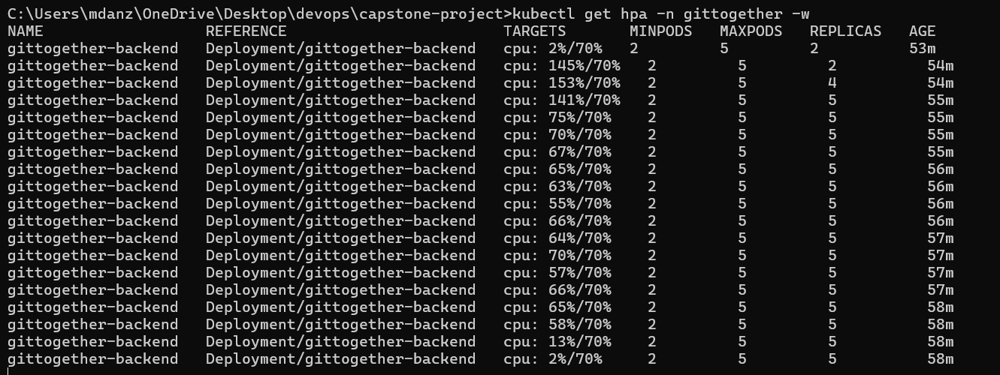

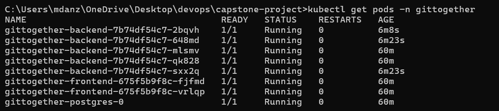

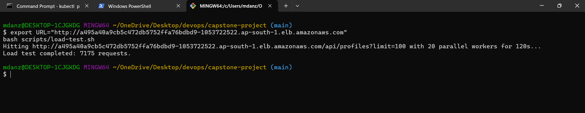

### Deploy a new version

The pipeline tags images with the commit SHA. Set `image.tag` in `helm/gittogether/values.yaml` to that
SHA and run `helm upgrade` (or just push it and let ArgoCD sync, see below). Roll back with
`helm rollback gittogether <revision> -n gittogether`.

### GitOps with ArgoCD

[`argocd/application.yaml`](argocd/application.yaml) makes ArgoCD deploy the chart straight from this repo
(`main`, `helm/gittogether`, `values-eks.yaml`) with automated sync, pruning and self-healing, so git is the
single source of truth: a manual `kubectl edit` is reverted, and a commit is rolled out by ArgoCD itself.

On EKS use the script, which installs ArgoCD and the Application in the right order (see the note below):

```bash
scripts/install-argocd-eks.sh
```

On the local kind cluster the plain steps are enough:

```bash
kubectl create namespace argocd
kubectl apply -n argocd --server-side -f https://raw.githubusercontent.com/argoproj/argo-cd/v3.5.5/manifests/install.yaml
kubectl apply -f k8s/namespace.yaml           # namespace with Pod Security labels
scripts/create-secrets.sh                     # DB password + JWT key, never in git
kubectl apply -f argocd/application.yaml
```

Then open the UI:

```bash
kubectl port-forward -n argocd svc/argocd-server 8081:443     # https://localhost:8081, user admin
kubectl get secret -n argocd argocd-initial-admin-secret -o jsonpath='{.data.password}' | base64 -d
```

> **Known issue on EKS 1.35 and 1.36.** On a fresh, empty cluster the API server answers `503` when
> asked for the OpenAPI schema in protobuf format (`/openapi/v2`), while the same schema works as JSON.
> This happens while the two metrics APIs (`v1.metrics.eks.amazonaws.com` from EKS and
> `v1beta1.metrics.k8s.io` from metrics-server) are registered. ArgoCD needs the schema, so the
> Application stays `Unknown` with "failed to load open api schema ... unable to handle the request".
> Removing both APIs fixes it (removing only one does not). `scripts/install-argocd-eks.sh` removes them,
> waits for ArgoCD to sync, and registers metrics-server's API again so the HPA works. I saw the same thing
> on 1.35 and 1.36 and did not find the root cause. A similar EKS problem was reported in
> [argo-cd#25976](https://github.com/argoproj/argo-cd/issues/25976). One side effect: ArgoCD no longer sees
> changes instantly, it notices drift at its next refresh (up to 3 minutes).

ArgoCD showing the app as Synced and Healthy, and the resource tree:

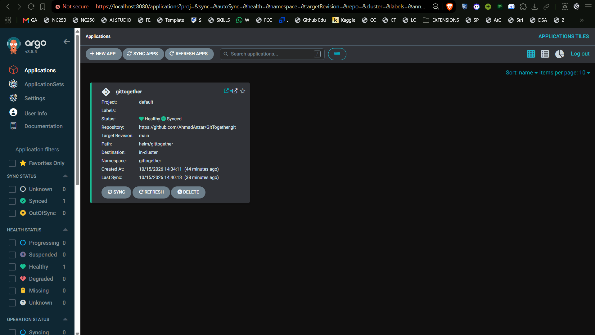

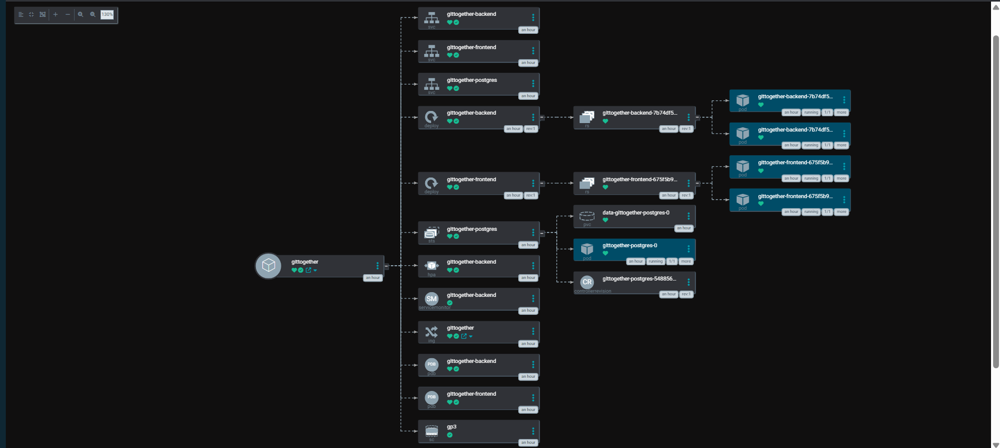

Release flow: CI builds and pushes `ghcr.io/ahmadanzar/gittogether/<component>:<commit SHA>`; you set
`image.tag` in `helm/gittogether/values.yaml` to that SHA and push; ArgoCD notices and rolls it out.
To roll back, revert the commit. On the local kind cluster, change `valueFiles` to `values-kind.yaml`.

### Troubleshooting lab

`troubleshooting/` contains two deliberately broken manifests (an image that doesn't exist, a Service
whose selector matches nothing). I ran both on the EKS cluster, found the cause with `kubectl describe`
and by comparing labels, and fixed them. The full steps with screenshots are in
[troubleshooting/README.md](troubleshooting/README.md).

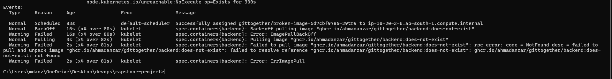

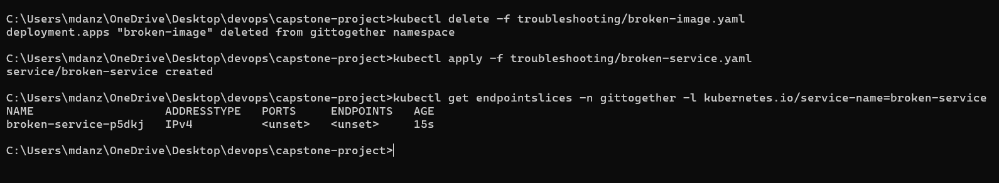

## Observability

The backend exposes Prometheus metrics at `/metrics` (request counts, latency histograms and sizes per
endpoint, via `prometheus-fastapi-instrumentator`). [`kube-prometheus-stack`](monitoring/prometheus-values.yaml)
runs Prometheus and Grafana in the cluster, and the chart's `ServiceMonitor` tells Prometheus to scrape
every backend pod (enabled in `values-kind.yaml` / `values-eks.yaml`). The ServiceMonitor needs the stack's
CRDs, so install monitoring **before** the app (ArgoCD simply retries until they exist). One script does it:

```bash
scripts/install-monitoring.sh
kubectl port-forward -n monitoring svc/monitoring-kube-prometheus-prometheus 9090   # Status -> Targets
kubectl port-forward -n monitoring svc/monitoring-grafana 3001:80                   # http://localhost:3001, user admin
kubectl get secret -n monitoring monitoring-grafana -o jsonpath='{.data.admin-password}' | base64 -d
```

In Prometheus, **Status -> Targets** shows both backend pods as `UP`. In Grafana, the **GitTogether API**
dashboard ([`monitoring/dashboards/gittogether-api.json`](monitoring/dashboards/gittogether-api.json)) is
imported automatically (the script stores it in a ConfigMap labelled `grafana_dashboard=1`, which Grafana's
sidecar watches). It shows backend pods up, requests per second, 5xx error ratio, p95 latency (overall and
per endpoint), responses by status class and backend CPU. `scripts/load-test.sh` generates traffic.

Prometheus targets (both backend pods are `UP`) and the Grafana dashboard during the load test:

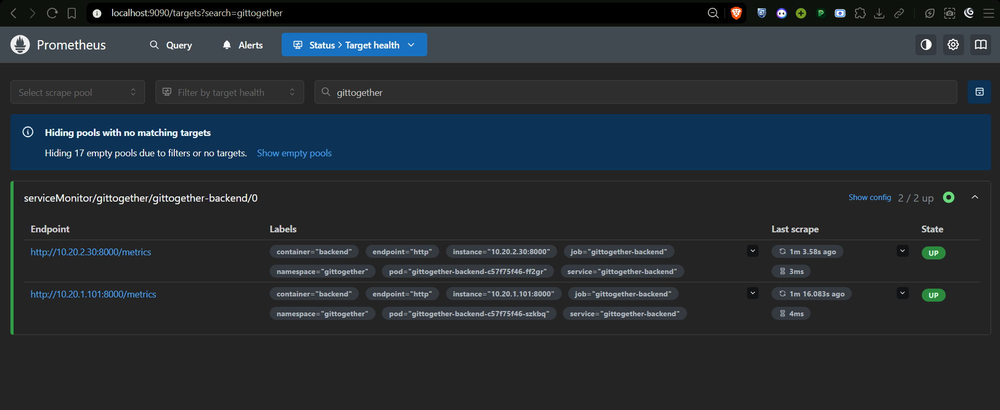

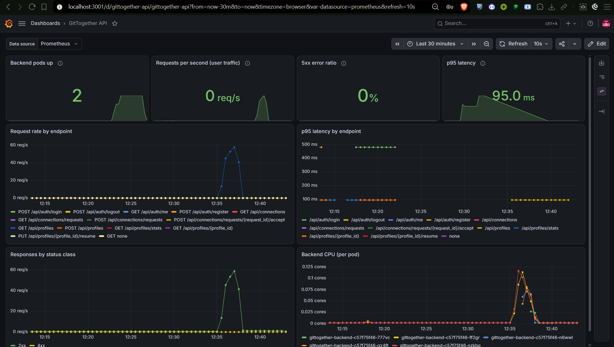

## Known limitations

- No email verification, password reset or login rate limiting yet; anyone can register with any email.
- Resumes are stored in PostgreSQL; at larger scale they would move to object storage (Amazon S3).
- Profiles created before accounts existed have no owner and are read-only.
- PostgreSQL runs inside the cluster with a PersistentVolumeClaim; production would use Amazon RDS.
- One NAT gateway is shared by both availability zones (cheaper, but a single point of failure).
