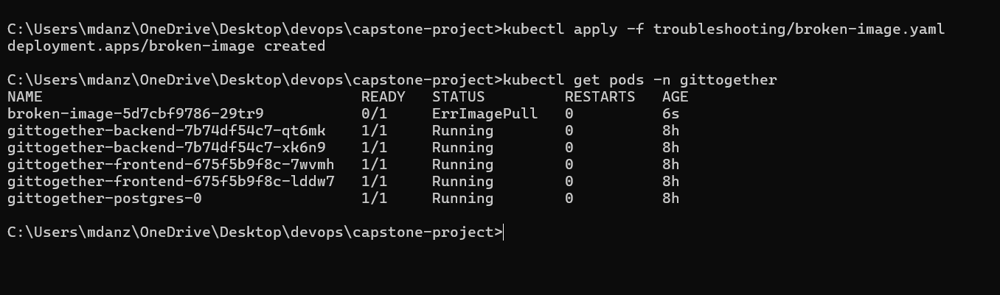
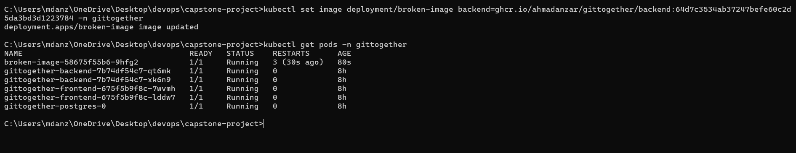
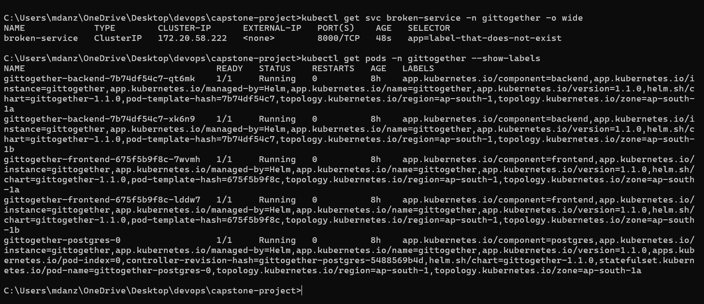
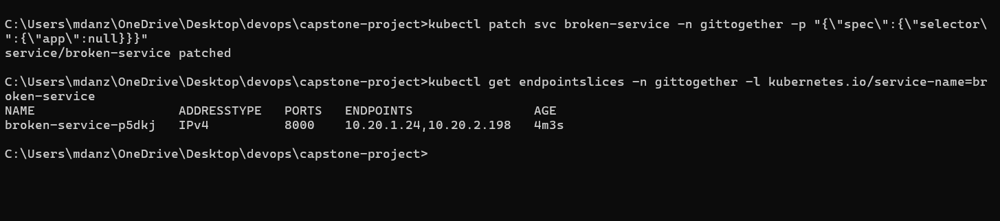

# Troubleshooting lab

Two things I broke on purpose on the EKS cluster, and how I found and fixed each one. The broken
manifests are in this folder. Both were deleted after the test, so the cluster is back to normal.

## 1. Image that doesn't exist (`ImagePullBackOff`)

`broken-image.yaml` is a Deployment that uses the tag `backend:does-not-exist`.

```bash
kubectl apply -f troubleshooting/broken-image.yaml
kubectl get pods -n gittogether
```

The pod never starts. Its status goes from `ErrImagePull` to `ImagePullBackOff`.



To see why, I looked at the pod's events:

```bash
kubectl describe pod -l app=broken-image -n gittogether
```

The events at the bottom say the image was not found. The registry has no tag with that name.


**Cause:** the tag was never pushed. My pipeline only pushes images tagged with the commit SHA.

**Fix:** use a tag that exists. I took the one the working backend uses and set it on the Deployment:

```bash
kubectl set image deployment/broken-image backend=ghcr.io/ahmadanzar/gittogether/backend:<commit SHA> -n gittogether
```

The `ImagePullBackOff` went away. The new pod then shows `Error`, which is a different problem: this
test pod has no database settings, so the app exits right after it starts. The image part is fixed.



## 2. Service that selects no pods

`broken-service.yaml` is a Service whose selector is `app: label-that-does-not-exist`.

```bash
kubectl apply -f troubleshooting/broken-service.yaml
kubectl get endpointslices -n gittogether -l kubernetes.io/service-name=broken-service
```

The `ENDPOINTS` column is `<unset>`. The Service exists, but nothing is behind it, so any request
to it would fail.


To find the cause I compared the Service's selector with the labels on the real pods:

```bash
kubectl get svc broken-service -n gittogether -o wide
kubectl get pods -n gittogether --show-labels
```

The selector asks for `app=label-that-does-not-exist`, but the backend pods carry
`app.kubernetes.io/name=gittogether` and `app.kubernetes.io/component=backend`.



**Cause:** a Service only sends traffic to pods whose labels match **all** of its selector.

**Fix:** point the selector at the backend labels. My first attempt used `kubectl patch`, which
*adds* keys and left the wrong `app` label in place, so there were still no endpoints. I had to
remove that key as well:

```bash
kubectl patch svc broken-service -n gittogether -p '{"spec":{"selector":{"app":null}}}'
```

After that the Service lists the two backend pod IPs on port 8000.



## What I took from this

- `kubectl describe` and its Events section is the first place to look when a pod won't start.
- "Service has no endpoints" almost always means the selector and the pod labels don't match.
- `kubectl patch` merges. To drop a wrong key you have to set it to `null`, or edit the manifest and re-apply.

## Clean up

```bash
kubectl delete -f troubleshooting/broken-image.yaml
kubectl delete -f troubleshooting/broken-service.yaml
```
